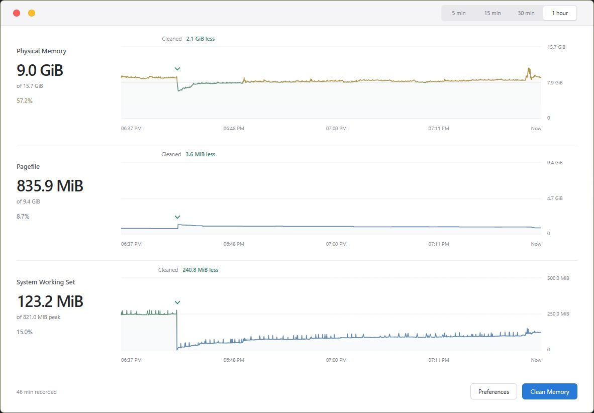

# OpenMemDuct

OpenMemDuct is a Windows memory monitor and cleanup app built with **React, Tauri, and Rust**.

Designed for a lightweight tray workflow, it pairs clear memory graphs with a live physical-memory percentage and configurable cleanup operations.

[Download for Windows](https://github.com/ShianMike/OpenMemDuct/releases/latest) · [Report an Issue](https://github.com/ShianMike/OpenMemDuct/issues)

**Unsigned release:** The Windows installer is currently unsigned. Windows may show **Unknown publisher** or a **SmartScreen** warning. Review the release details and checksum below before deciding whether to run it; keep Windows protections enabled.



## Features

- **Three memory graphs** — Physical Memory, Pagefile, and System Working Set, with up to one hour of history.
- **Live tray percentage** — See physical-memory usage while the dashboard is closed.
- **Start with Windows (next release)** — Launch automatically at sign-in and manage the entry in Windows Startup Apps. Not included in 0.1.0.
- **One cleanup approval per session (next release)** — Approve the first cleanup, then clean again without repeated administrator prompts while the tray app keeps running. Not included in 0.1.0.
- **One-click cleanup** — Choose from eight cleanup targets and inspect before/after results directly on the graphs.
- **Optional automation** — Configure a usage threshold, cleanup interval, or global keyboard shortcut.
- **A focused light interface** — Glass panels, a custom title bar, keyboard controls, and reduced-motion support.
- **Local data** — Settings are saved locally; graph history stays in memory.

## Requirements

- Windows 11, x64.
- Microsoft Edge WebView2 Runtime.
- Administrator approval for memory cleanup. Monitoring works without elevation.

Cleanup is currently enabled for **Windows build 26200**. Other builds remain in monitoring mode until their cleanup compatibility is validated.

## Getting Started

Download the Windows x64 setup EXE from the [latest release](https://github.com/ShianMike/OpenMemDuct/releases/latest), run the installer, and open OpenMemDuct.

1. Open **Preferences → Memory** and choose the regions to clean.
2. Select **Clean Memory**. Results appear on each graph; select a result label for details.
3. Close the dashboard to keep the tray monitor running. Use **Open** to return or **Quit** from the tray menu to exit.

**Next release (not in 0.1.0):** To launch at sign-in, enable **Preferences → General → Start with Windows**. Enable **Start in Tray** as well to keep the dashboard closed when the app starts.

Automatic cleanup and the global shortcut are off by default. Automatic cleanup runs only in an existing administrator session on a supported Windows build.

Cleanup results report observed memory changes. Trimming caches can increase subsequent disk activity, and performance depends on the workload.

## Development

Install the [Windows development prerequisites](CONTRIBUTING.md#prerequisites), then run:

```powershell
npm ci
npm run tauri -- dev
```

For UI work with simulated data, use `npm run dev` and open <http://127.0.0.1:1420/>.

See [Contributing](CONTRIBUTING.md) for checks and project structure.

## Release Status

Version 0.1.0 is available for Windows 11 x64. Release downloads include the unsigned NSIS installer `OpenMemDuct_0.1.0_x64-setup.exe` and `SHA256SUMS`.

Download both files from the same release into one folder, open PowerShell there, and run:

```powershell
Get-FileHash -Algorithm SHA256 -LiteralPath .\OpenMemDuct_0.1.0_x64-setup.exe
Get-Content -LiteralPath .\SHA256SUMS
```

Compare the reported hash with the entry for `OpenMemDuct_0.1.0_x64-setup.exe` in `SHA256SUMS` (letter case does not matter). If they differ, do not run the installer. A match confirms the downloaded bytes match the published checksum; it is not a trusted publisher signature or a safety guarantee.

Cleanup remains limited to build 26200. Clean-machine coverage, additional Windows builds, and controlled performance comparisons are ongoing.

See the [changelog](CHANGELOG.md) and [release preparation guide](docs/RELEASING.md) for the current scope and remaining checks.

## License

[MIT](LICENSE).

See the [security policy](.github/SECURITY.md) to report a vulnerability privately.
