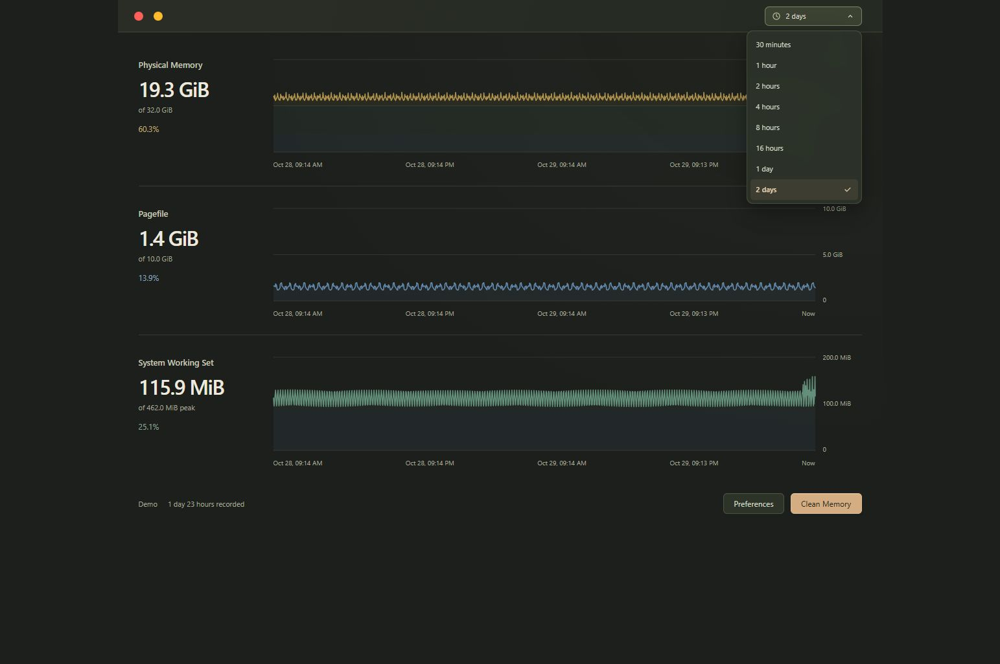

# OpenMemDuct

OpenMemDuct is a Windows memory monitor and cleanup app built with **React, Tauri, and Rust**.

Designed for a lightweight tray workflow, it pairs clear memory graphs with a live physical-memory percentage and configurable cleanup operations.

[Download 0.1.3 for Windows](https://github.com/ShianMike/OpenMemDuct/releases/download/v0.1.3/OpenMemDuct_0.1.3_x64-setup.exe) · [Report an Issue](https://github.com/ShianMike/OpenMemDuct/issues)

**Unsigned Windows installer:** The installer and app binaries have no Windows Authenticode publisher signature. Tauri updater signatures authenticate in-app updates separately. Windows may show **Unknown publisher** or a **SmartScreen** warning. Review the release details and checksum below before deciding whether to run it; keep Windows protections enabled.




## Features

- **Three memory graphs** — Physical Memory, Pagefile, and System Working Set, with a custom time-range dropdown: 30 minutes, 1 hour, 2 hours, 4 hours, 8 hours, 16 hours, 1 day, or 2 days. Day-long ranges include dates in chart labels and inspected timestamps.
- **Up to 48 hours of session history** — The recent hour uses one-second buckets; older five-minute buckets preserve first and last readings, peaks, troughs, and unavailable readings. History stays in memory while the tray app runs and clears when you quit.
- **Light, Dark, or System appearance** — Dark mode uses warm graphite and moss with copper accents. System follows Windows appearance changes. Preview a choice immediately in Preferences, then save it or cancel to restore your saved appearance.
- **Live tray percentage** — See physical-memory usage while the dashboard is closed.
- **Start with Windows** — Launch automatically at sign-in and manage the entry in Windows Startup Apps.
- **One cleanup approval per session** — Approve the first cleanup, then clean again without repeated administrator prompts while the tray app keeps running.
- **Optional automatic updates** — Opt in to updates authenticated by the app's updater signature. Off by default.
- **One-click cleanup** — Choose from eight cleanup targets and inspect before/after results directly on the graphs.
- **Optional automation** — Configure a usage threshold, cleanup interval, or global keyboard shortcut.
- **A focused interface** — Glass panels, improved frost on cleanup detail popovers, a custom title bar, keyboard controls, and reduced-motion support.
- **Local data** — Settings are saved locally; graph history stays in memory.

## Requirements

- Windows 11, x64.
- Microsoft Edge WebView2 Runtime.
- Administrator approval for memory cleanup. Monitoring works without elevation.

Cleanup is currently enabled for **Windows build 26200**. Other builds remain in monitoring mode until their cleanup compatibility is validated.

## Getting Started

Download the [0.1.3 Windows x64 setup EXE](https://github.com/ShianMike/OpenMemDuct/releases/download/v0.1.3/OpenMemDuct_0.1.3_x64-setup.exe), run the installer, and open OpenMemDuct.

1. Open **Preferences → Memory** and choose the regions to clean.
2. Select **Clean Memory**. Results appear on each graph; select a result label for details.
3. Close the dashboard to keep the tray monitor running. Right-click the tray icon and select **Clean memory** to use your saved cleanup regions, **Open** to return, or **Quit** to exit.

To launch at sign-in, enable **Preferences → General → Start with Windows**. Enable **Start in Tray** as well to keep the dashboard closed when the app starts.

Find the current app version under **Preferences → General → Updates**.

Choose a chart duration from the dropdown in the title bar. Longer ranges show only readings collected during the current app session; selecting two days does not fill in earlier history. Closing and reopening the dashboard retains history while the tray app keeps running.

Choose **Light**, **Dark**, or **System** under **Preferences → General → Appearance** for an immediate preview. Select **Save** to keep it across launches, or **Cancel** to restore your saved appearance. System is the default, including for older preferences without an appearance setting.

To opt in to automatic updates, enable **Preferences → General → Install updates automatically**. OpenMemDuct checks GitHub Releases at startup and every six hours while enabled. Closing the dashboard keeps the cleanup approval session active; quitting OpenMemDuct ends it.

Automatic cleanup and the global shortcut are off by default. Automatic cleanup runs only in an existing administrator session on a supported Windows build.

Cleanup results report observed memory changes. Trimming caches can increase subsequent disk activity, and performance depends on the workload.

## Development

Install the [Windows development prerequisites](CONTRIBUTING.md#prerequisites), then run:

```powershell
npm ci
npm run tauri -- dev
```

For UI work with simulated data, use `npm run dev` and open <http://127.0.0.1:1420/>.

See [Contributing](CONTRIBUTING.md) for checks and project structure.

## Release Status

Version **0.1.3**, dated **2026-10-30** (Asia/Manila), targets Windows 11 x64. It adds eight chart durations, bounded two-day session history, date-aware labels for day-long ranges, and Light/Dark/System appearance with immediate preview, saved choices, and cancellation that restores the saved appearance.

See the [v0.1.3 release notes](https://github.com/ShianMike/OpenMemDuct/releases/tag/v0.1.3) for published assets, the exact source commit, Windows Checks and Package CI results, installer checksum, and runtime validation coverage.

The release artifact set is `OpenMemDuct_0.1.3_x64-setup.exe`, `OpenMemDuct_0.1.3_x64-setup.exe.sig`, `latest.json`, and `SHA256SUMS`. The checksum file covers the installer, signature, and manifest.

Download the installer and [SHA256SUMS](https://github.com/ShianMike/OpenMemDuct/releases/download/v0.1.3/SHA256SUMS) from the same release into one folder, open PowerShell there, and run:

```powershell
Get-FileHash -Algorithm SHA256 -LiteralPath .\OpenMemDuct_0.1.3_x64-setup.exe
Get-Content -LiteralPath .\SHA256SUMS
```

Compare the reported hash with the entry for `OpenMemDuct_0.1.3_x64-setup.exe` in `SHA256SUMS` (letter case does not matter). If they differ, do not run the installer. A match confirms the downloaded bytes match the published checksum; it is not a trusted publisher signature or a safety guarantee.

The original 0.1.0 installer has no in-app updater, and its immutable release has no updater signature or manifest. Version 0.1.1 introduced optional automatic updates. Users of the original 0.1.0 installer need one manual upgrade to 0.1.1 or a later release to gain the updater. Live updates require the installer, matching `.exe.sig`, and `latest.json` to be published together; the 0.1.0 release remains unchanged. The Tauri updater signature authenticates updates to the app; it is separate from paid Windows Authenticode signing, so the installer and app binaries still have no verified Windows publisher identity.

Cleanup remains limited to Windows 11 x64 build 26200. Clean-machine installation/uninstallation, installed upgrades, reboot startup, additional Windows builds, and controlled performance comparisons require separate validation; source tests and artifact checks do not establish that coverage.

See the [changelog](CHANGELOG.md) and [release preparation guide](docs/RELEASING.md) for the current scope and remaining checks.

## License

[MIT](LICENSE).

See the [security policy](.github/SECURITY.md) to report a vulnerability privately.
